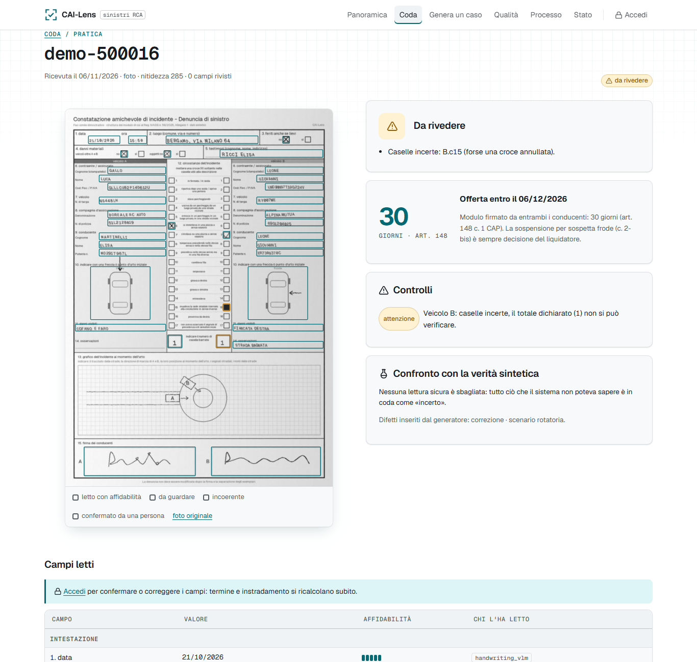
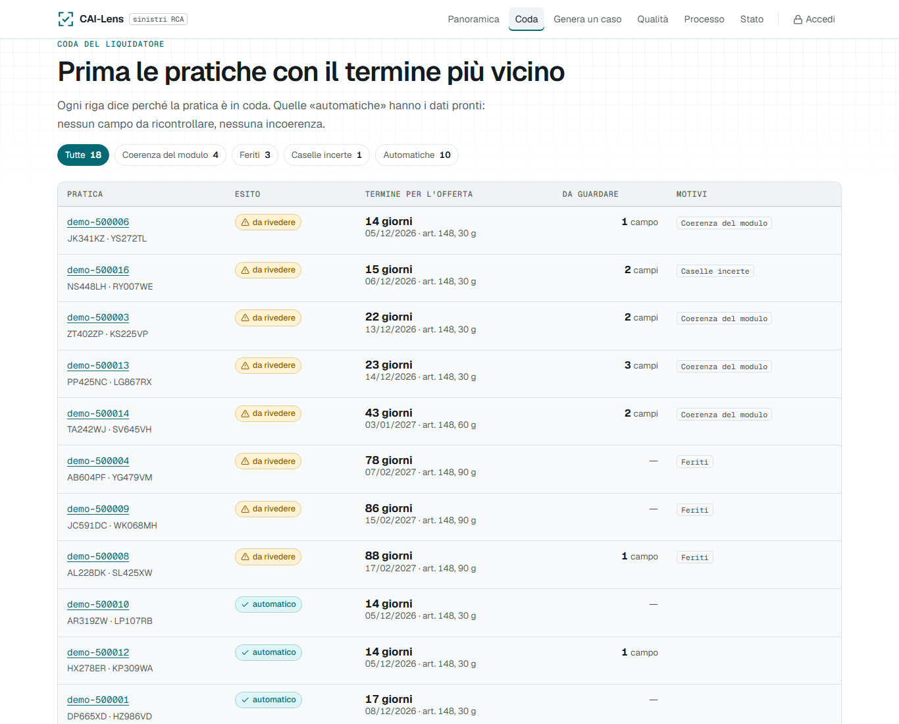

# CAI-Lens

[](LICENSE)

**Reads the Italian accident report form (CAI) and says what it could not read with certainty.** Crosses and
signatures are measured by computer vision, handwriting and the sketch are read by a vision model, and rules,
the art. 148 CAP deadline and routing are plain code. Every field comes with a confidence; what is uncertain
goes to a claims handler with the reason and the legal term for the offer. Agents can use it through an MCP
server.

Five-minute walkthrough: [docs/DEMO.md](docs/DEMO.md).

> Technical demo on **synthetic data only**: no real form, person, plate, policy or insurer. The form is drawn
> from scratch after the structure of Reg. IVASS n. 56/2025, Allegato 1. The system prepares data and flags
> what to check; liability and the offer stay with the claims handler.



## Why it is built this way

A CAI form decides money and a legal deadline: under art. 148 CAP the insurer must make an offer within
**60 days**, **30** if both drivers signed the form, **90** with injuries. Whether a signature is there changes
the term; whether a box is crossed changes the dynamics. Vision models are weak exactly there — on the public
CheckboxQA benchmark (2025) the best model scores 83/100 against 97.5 for a person — so the pixels decide the
crosses and signatures, the model reads only what needs reading, and every number below is measured.

## What it does

Nine agents in a fixed order (an explicit state machine, every step logged with time, tokens and cost):

| Agent | How | Job |
|---|---|---|
| registrar | OpenCV | finds the page and the printed frame, maps the photo onto the template, measures sharpness; no frame or a poor photo → nobody reads blindly |
| checkbox | OpenCV | ink inside each of the 40 boxes, after removing long lines (fold creases) and compact blobs (pen dots); a box full of ink is a scratched-out cross → *uncertain* |
| signature | OpenCV | presence (not identity) of the two signatures |
| handwriting | Claude vision | each text field cut into its own strip, one mosaic, strict JSON schema; confidence from readability and field shape, not from the model's opinion |
| sketch | Claude vision | accident type from section 13 and impact point from section 10, as a cross-check |
| validator | code | declared number of crosses, codice fiscale check character, plates, dates, mandatory data of vehicle B, sketch vs boxes |
| deadline | code | art. 148: 30 / 60 / 90 days; an uncertain input takes the **shortest** possible term and is marked provisional; suspected fraud (c. 2-bis) is never decided by code |
| router | code | *automatico* (data ready, nothing to re-check) or *revisione* with the list of fields to look at |
| verifier | Claude vision | only before *automatico*: a second, larger reading of plates, policies, codici fiscali and the date; any disagreement → a person |

The web app is the claims handler's desk: a queue ordered by the art. 148 term, a case page with the form and a
frame on every field read, field review (append-only; rules, term and route are recomputed at once), a page to
build a synthetic case to order, evals and a process monitor. MCP tools: `read_cai`, `deadline_148`,
`check_codice_fiscale`, `make_synthetic_case`.

## Measured (21 Nov 2026)

Synthetic forms with known truth. **dev** (200) was used to set the thresholds; **holdout** (100) was not, and
is harder: more skewed and blurred photos, two handwriting styles never seen in dev. Model: `claude-opus-5-5`.
Reports: [`evals/results/`](evals/results/); every model answer is kept in [`evals/llm_cache/`](evals/llm_cache/),
so `cai-eval --replay` reproduces the numbers offline and for free.

| | dev (200) | holdout (100) |
|---|---|---|
| Boxes read wrong without a warning | 0 of 7 987 | **0 of 3 991** |
| Scratched-out crosses sent to a person | 13 / 13 | 9 / 9 |
| Signatures (absent read absent · present read present) | 49 / 49 · 351 / 351 | 24 / 24 · 176 / 176 |
| art. 148 term correct · never later than due | 100% · 100% | 100% · 100% |
| Handwriting, exact (all 28 fields) | 99.4% | 97.6% |
| Handwriting, exact when marked reliable | 99.7% | 99.5% |
| Accident type · impact point from the sketch | 100% · 100% | 100% · 100% |
| Defects planted by the generator and flagged (8 kinds) | 100% each | 100% each |
| Cases routed *automatico* | 49% | 39% |
| …of those with a wrong key field | 1 of 98 | **1 of 39** |
| Model cost · time per case | $0.040 · 9.6 s | $0.039 · 9.6 s |
| Computer vision per case (median) | 168 ms | 167 ms |

**The residual error, plainly.** In both splits the one automatic case with a wrong field is a plate digit
(3→8, 5→6) where the synthetic glyph really looks like the wrong digit — both readings agreed, and so would a
person. Before the verifier agent existed, holdout had 3 such cases out of 44; the second reading caught the
other two.

**Hybrid vs. one model call on the whole page** (same 40 dev forms, [`baseline-dev-40.json`](evals/results/baseline-dev-40.json)):

| | hybrid | model only |
|---|---|---|
| Boxes read wrong without a warning | 0 / 1 596 | 8 / 1 596 |
| Scratched-out crosses flagged | 4 / 4 | 0 / 4 |
| Signatures wrong | 0 / 80 | 0 / 80 |
| Handwriting exact | 99.5% | 99.7% |
| Cost per case | $0.039 | $0.025 |

The model alone reads handwriting as well and is cheaper; it is the boxes it gets wrong, silently, and it never
says "this one was crossed out". That is the case for the hybrid.

**When the photo gets worse** ([`stress.json`](evals/results/stress.json), `scripts/stress.py`): five levels
from good to extreme (rotation up to 15°, blur up to σ 3.4, JPEG quality down to 10), 25 forms each.
**0 silent errors at every level**: poor photos are flagged «verify by eye», the worst are refused by the
registrar. The first version had **36 silent errors in 1 000 boxes** at the «pessima» level — the page was
straightened correctly but blurred crosses vanished. The fix was a sharpness gate (variance of the Laplacian;
holdout photos ≥ 51, the failing level ≤ 38).

**Engineering checks:** 64 tests (Hypothesis properties: the term is never later than any term the facts allow;
crash cases: blank page, noise, broken JPEG, model down, path traversal in the MCP tool), 95% branch coverage,
ruff, mypy strict, bandit, and [`scripts/mutation_check.py`](scripts/mutation_check.py): 38 bugs injected on
purpose (in rules, vision, registrar, verifier, review, LLM layer, web security) — **38 / 38 caught by the tests**
([`docs/mutation-results.json`](docs/mutation-results.json)). Render gates: 10 pages × 2 widths × 2 themes,
all passing. Before release the demo is also run end to end in the production container
(read-only image, non-root user, 1 CPU / 1 GB): anonymous visitor, two reviewers on the shared demo account,
an attacker (CSRF, open redirect, path traversal, XSS, brute force, forged cookies) and live cases built with
the real model. That run found two bugs the unit tests had not: a live answer was lost because the cassette
could not be written on a read-only image, and the review view dropped the verifier's veto on a codice fiscale.
Both now have a test and a mutation.



## Run it

```bash
python -m venv .venv && . .venv/bin/activate      # Windows: .venv\Scripts\activate
pip install -c requirements.lock -e ".[dev]"
pytest                                            # offline: synthetic forms, fake vision model
cai-eval --split holdout --n 100 --replay         # the numbers above, from the cassette, no API calls
uvicorn cailens.web:create_app --factory --port 8050
```

With `ANTHROPIC_API_KEY` set (or in a git-ignored `.env.local`), new cases are read live; without it the
deterministic part still works and text fields go to review. Docker: `docker build -t cai-lens .`.

## Known limits

- The forms are synthetic: handwriting is simulated by deforming typefaces. On real forms the numbers will be
  different; the first step with an insurer is a labelled set of real forms.
- The vision agents know the layout: another form template needs another field map (a file, not retraining).
- A signature is detected as present, never verified as someone's.
- The public demo accepts no real photos on purpose (personal data and, with injuries, health data).

## License

MIT — see [LICENSE](LICENSE). Fonts: Geist, Geist Mono (SIL OFL 1.1). Icons: Lucide (ISC).
